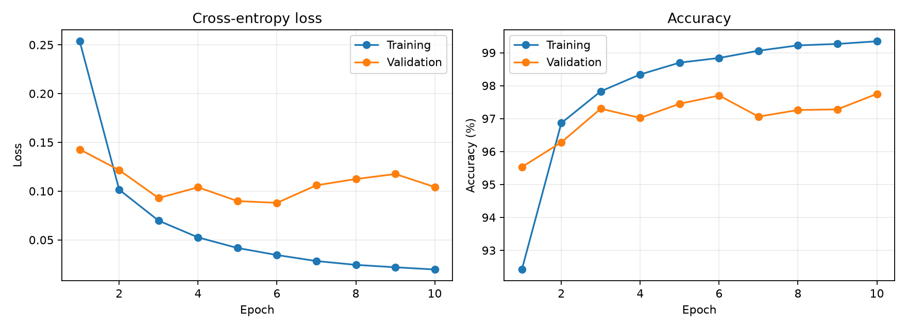
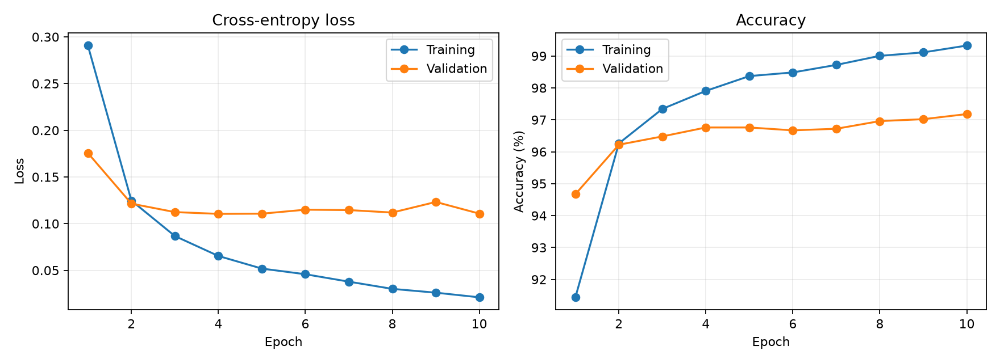
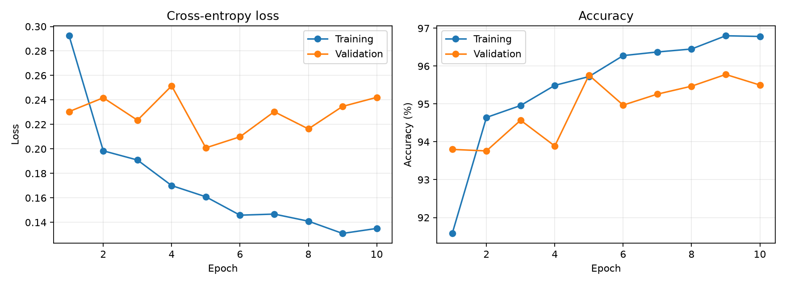
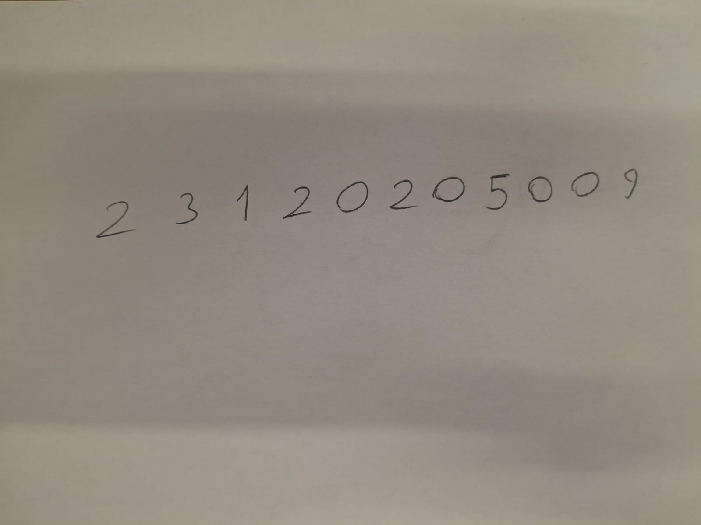
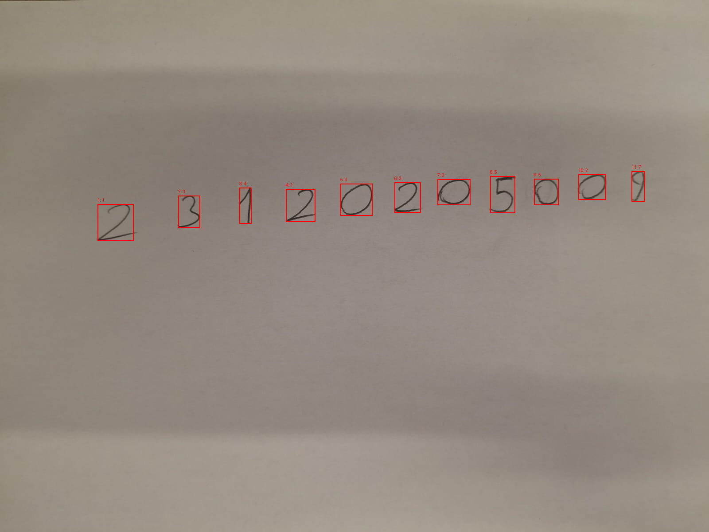
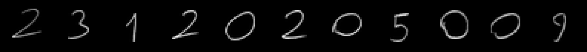

# MNIST ile MLP Tabanlı El Yazısı Rakam Tanıma

Bu proje, MNIST rakamlarını PyTorch ile sıfırdan eğitilmiş MLP modelleriyle sınıflandırır. Üç konfigürasyon validation sonuçlarıyla karşılaştırılır; seçilen model öğrencinin kendi el yazısıyla yazdığı okul numarası fotoğrafında denenir. CNN ve hazır eğitilmiş model kullanılmaz.

## Kurulum ve çalıştırma

Komutları proje ana klasöründe çalıştırın. Python, PyTorch, torchvision, NumPy, Matplotlib ve Pillow kullanılır.

```powershell
python -m venv .venv
.venv\Scripts\Activate.ps1
python -m pip install -r requirements.txt
```

PowerShell aktivasyon engeli varsa komutlarda `python` yerine `.venv\Scripts\python.exe` kullanabilirsiniz.

Eğitimler tamamlanmıştır; kayıtlı modeli kullanmak için tekrar eğitim gerekmez:

```powershell
python -m src.handwriting --image handwriting/student_id.jpeg --expected 23120205009
```

Fotoğrafın gerçek uzantısı **`.jpeg`** şeklindedir. Bu komut MNIST indirmez; `models/baseline.pt` dosyasını kullanır. `--expected` yalnızca sonuçları karşılaştırır; segmentasyona veya model girdisine katılmaz. Bu seçenek olmadan da tahmin alınabilir.

Eğitimi baştan tekrarlamak için:

```powershell
python main.py --epochs 10 --batch-size 64 --seed 42
```

Bu komut mevcut model ve eğitim sonuç dosyalarının üzerine yazar. İlk eğitim çalıştırmasında MNIST otomatik indirilir; internet gerekir. CUDA varsa GPU, aksi halde CPU kullanılır. Farklı ortamlar yeniden eğitimde aynı sayıları üretmeyebilir.

## Veri seti ve ayrım

MNIST, 0–9 sınıflarına ait 70.000 adet 28×28 gri tonlamalı rakam görüntüsünden oluşur.

| Küme | Görüntü sayısı | Kullanım |
|---|---:|---|
| Training | 50.000 | Model ağırlıklarının öğrenilmesi |
| Validation | 10.000 | Epoch/checkpoint ve konfigürasyon seçimi |
| Test | 10.000 | Seçilen modelin nihai değerlendirmesi |

Resmî 60.000 örneklik eğitim kümesi `seed=42` ile training/validation olarak ayrılır. Resmî test kümesi model geliştirme ve hiperparametre seçimi için kullanılmaz. Görüntüler `ToTensor()` ile [0, 1] aralığına getirilir ve `(x - 0.1307) / 0.3081` ile normalize edilir.

## Mimari ve hiperparametreler

Baseline mimarisi: **Flatten → Linear(784, 256) → ReLU → Linear(256, 128) → ReLU → Linear(128, 10)**.

İki gizli katman vardır. Son katman ham logits üretir; `CrossEntropyLoss` öncesinde ayrıca softmax uygulanmaz. Tahmin confidence değerleri için softmax kullanılır.

Tüm deneylerde Adam, CrossEntropyLoss, 10 epoch, batch size 64 ve seed 42 kullanılmıştır.

| Deney | Gizli katmanlar | Learning rate | En iyi epoch |
|---|---|---:|---:|
| Baseline | 256, 128 | 0.001 | 6 |
| Small | 128, 64 | 0.001 | 4 |
| Higher LR | 256, 128 | 0.01 | 5 |

Her deneyde minimum validation loss üreten checkpoint kaydedilir. Bu checkpoint'ler arasından yine minimum validation loss ile nihai model seçilir.

## Gerçek eğitim sonuçları

Aşağıdaki değerler [summary.json](results/summary.json) ve epoch bazlı CSV kayıtlarından alınmıştır. Loss ve accuracy değerleri her deneyin **en iyi validation loss üreten epoch'una**, süreler ise 10 epoch'luk eğitimin tamamına aittir. Training metrikleri o epoch boyunca ağırlık güncellemeleri sırasında ölçülmüştür.

| Deney | Train loss | Validation loss | Train accuracy | Validation accuracy | Süre (sn) |
|---|---:|---:|---:|---:|---:|
| Baseline | 0.034474 | 0.087986 | %98.840 | %97.70 | 164.8017 |
| Small | 0.065401 | 0.110484 | %97.906 | %96.76 | 156.5241 |
| Higher LR | 0.160894 | 0.200868 | %95.724 | %95.76 | 183.8451 |

**Seçilen model Baseline'dır.** Nihai test loss **0.077985**, test accuracy **%97,75** olarak ölçülmüştür. Diğer iki model için test sonucu üretilmemiştir; seçim yalnızca validation verisiyle yapılmıştır.

Bu çalıştırmada küçük ağın validation accuracy değeri Baseline'dan 0,94 yüzde puan düşüktür; eğitim süresi yaklaşık 8,3 saniye daha kısadır. Learning rate'i 0.001'den 0.01'e çıkarmak validation accuracy değerini 1,94 yüzde puan azaltmıştır. Higher LR bu çalıştırmada daha uzun sürmüştür; tek çalıştırma sürelerinden genel bir hız kuralı çıkarılamaz.

Baseline'ın seçilen epoch'undaki train/validation accuracy farkı 1,14 yüzde puandır. Eğitim geçmişinde 6. epoch sonrasında training loss azalırken validation loss'un yükselmesi aşırı öğrenme eğilimine işaret eder. Bu nedenle son epoch yerine validation loss'u en düşük checkpoint kullanılmıştır. Her konfigürasyon tek seed ile çalıştırıldığı için sonuçlar tekrarlı deneylerin istatistiksel ortalaması değildir.

## Loss ve accuracy grafikleri

Grafiklerin sol tarafı loss, sağ tarafı accuracy değerlerini gösterir. Tüm grafikler kaydedilmiş gerçek 10 epoch'luk geçmişe aittir.

### Baseline



[Epoch kayıtları](results/baseline_metrics.csv)

### Small



[Epoch kayıtları](results/small_metrics.csv)

### Higher LR



[Epoch kayıtları](results/higher_lr_metrics.csv)

## Kendi el yazımla okul numarası deneyi

Öğrencinin sağladığı gerçek fotoğraf kullanılmıştır; yapay el yazısı üretilmemiştir. Gerçek okul numarası öğrenci tarafından **23120205009** olarak doğrulanmıştır.



İlk segmentasyon kodu fotoğraftaki gölgeli kâğıt arka planını da mürekkep sayarak tüm fotoğrafı tek bölge olarak alıyordu. Düzeltilen işlem sırası şöyledir:

1. EXIF yönünü düzeltme ve gri tonlamaya dönüştürme; gerektiğinde polariteyi çevirme.
2. Gaussian blur ile yavaş değişen arka plan aydınlığını tahmin etme, arka plandan farkı alarak kalem izlerini ortaya çıkarma ve kontrastı ölçekleme.
3. Düzeltilmiş kalem yoğunluğunda `threshold=110` ile maske oluşturma; 20 pikselden küçük bağlantılı lekeleri ve görüntü kenarına temas eden bölgeleri ayıklama.
4. Dolu sütun gruplarından rakamları soldan sağa ayırma ve kırpma.
5. En-boy oranını koruyarak en uzun kenarı 20 piksele ölçekleme, 28×28 siyah zemine yerleştirme ve mürekkep ağırlık merkezine göre merkezleme.
6. Checkpoint'teki eğitim normalizasyonunu uygulama ve mevcut Baseline modeliyle tahmin etme.

Bu fotoğrafta arka plan blur yarıçapı 40 pikseldir (`max(genişlik, yükseklik) / 40`). Gerçek numara rakam sayısını zorlamak, ön işlemeyi seçmek veya tahminleri düzeltmek için kullanılmamıştır. Model yeniden eğitilmemiştir.





### Gerçek tahmin ve karşılaştırma

- Gerçek numara: **23120205009**
- Tahmin edilen numara: **13410205527**
- Algılanan rakam sayısı: **11**
- Doğru rakam sayısı: **5 / 11 (%45,45)**
- Numaranın tamamı doğru mu: **Hayır**

| Sıra | Gerçek | Tahmin | Confidence | Sonuç |
|---|---:|---:|---:|---|
| 1 | 2 | 1 | %50.28 | Yanlış |
| 2 | 3 | 3 | %95.85 | Doğru |
| 3 | 1 | 4 | %50.66 | Yanlış |
| 4 | 2 | 1 | %64.21 | Yanlış |
| 5 | 0 | 0 | %97.60 | Doğru |
| 6 | 2 | 2 | %93.04 | Doğru |
| 7 | 0 | 0 | %69.31 | Doğru |
| 8 | 5 | 5 | %99.41 | Doğru |
| 9 | 0 | 5 | %74.38 | Yanlış |
| 10 | 0 | 2 | %73.61 | Yanlış |
| 11 | 9 | 7 | %93.36 | Yanlış |

Makine tarafından okunabilir ayrıntılar: [tahmin CSV dosyası](results/handwriting/predictions.csv), [el yazısı deney özeti](results/handwriting/summary.json). [Arka planı düzeltilmiş görüntü](results/handwriting/preprocessed.png) ve `results/handwriting/digit_1.png`–`digit_11.png` dosyaları da kaydedilir.

### Değerlendirme ve distribution shift

MNIST test accuracy değeri %97,75 iken bu tek fotoğraftaki rakam doğruluğu %45,45'tir. 11 rakamlık tek örnek, gerçek dünyadaki genel başarıyı ölçmek için yeterli değildir; bu deney farklı veri koşullarına geçişteki sorunu gösterir.

Fotoğraftaki ince kalem çizgileri, eğik yazım, farklı rakam biçimleri, gölgeler ve küçültme sırasında çizgi yoğunluğunun değişmesi MNIST girdilerinden farklı özellikler oluşturabilir. Örneğin 1. ve 4. sıradaki `2` rakamları `1`, 3. sıradaki `1` rakamı `4` olarak tahmin edilmiştir. 9. ve 10. sıradaki `0` rakamlarının `5` ve `2` olması, 11. sıradaki `9` rakamının `7` olması da biçim/yoğunluk farklarıyla ilişkili olabilir. Bunlar olası açıklamalardır; tek fotoğrafla kesin neden saptanamaz.

Confidence, modelin softmax çıktısıdır ve tahminin gerçekten doğru olma garantisi değildir. Son rakam yanlış olmasına rağmen %93,36 confidence üretilmiştir. Segmentasyon görselinde 11 rakamın ayrıldığı görülür; ayrıştırmanın düzelmesi sınıflandırmanın da tamamen doğru olacağını garanti etmez. Düşük başarı gizlenmemiş, gerçek çıktı raporlanmıştır.

## Dosyalar, kontroller ve teslim

```text
main.py                         Eğitim giriş noktası
src/model.py                    MLP mimarisi
src/data.py                     MNIST, veri ayrımı ve normalizasyon
src/train.py                    Eğitim, validation seçimi ve nihai test
src/handwriting.py              Fotoğraf işleme, tahmin ve karşılaştırma
models/*.pt                     Üç deneyin en iyi checkpoint dosyaları
results/summary.json            Gerçek eğitim özeti
results/*_metrics.csv           Epoch bazlı gerçek metrikler
results/*_curves.png            Eğitim grafikleri
handwriting/student_id.jpeg     Öğrencinin gerçek fotoğrafı
results/handwriting/            Gerçek el yazısı tahminleri ve görseller
tests/                          Model, segmentasyon ve karşılaştırma kontrolleri
requirements.txt                Çalışma bağımlılıkları
.gitignore                      Yerel ortam, önbellek ve MNIST indirmeleri
```

Ek test bağımlılığı gerektirmeyen kontroller:

```powershell
python -m unittest discover -s tests -v
```

Kontroller model çıktı boyutunu ve geri yayılımı, gölgeli ve ters renkli girdileri, boş fotoğrafı, normalizasyonu, eksik rakam durumunu ve gerçek etiketin tahminleri değiştirmediğini kapsar. Şekil testleri için geçici geometrik çizgiler kullanılır; bunlar öğrenci el yazısı deneyi değildir.

El yazısı akışı Windows üzerinde Python 3.14.10, torch 2.14.1+cpu, torchvision 0.29.1+cpu, NumPy 2.5.4, Matplotlib 3.11.2 ve Pillow 12.3.0 ile çalıştırılmıştır. Eğitim sonuçları mevcut kayıtlardan korunmuştur; eğitimin başlangıç ortamı ayrıca kaydedilmemiştir.

GitHub'a kodları, `tests/`, `models/`, `results/`, `handwriting/`, README, requirements ve `.gitignore` dosyalarını ekleyin. `.venv/`, `__pycache__/` ve yeniden indirilebilir `data/` klasörünü eklemeyin. Mevcut her checkpoint 1 MB'tan küçüktür.

GitHub'da boş bir repository oluşturduktan sonra proje klasöründe şu komutları çalıştırın (`REPO_URL` yerine kendi repository adresinizi yazın):

```powershell
git init
git add .
git commit -m "Complete MNIST MLP experiments and handwriting evaluation"
git branch -M main
git remote add origin REPO_URL
git push -u origin main
```

Yüklemeden sonra GitHub üzerinde grafiklerin, fotoğrafın, checkpoint'lerin ve sonuç dosyalarının bulunduğunu kontrol edip repository bağlantısını teslim edin. Başka bir bilgisayarda repository klonlandıktan sonra kurulum ve el yazısı komutları aynı şekilde kullanılabilir.

Farklı fotoğraflarda rakamlar tek satırda, aralarında boşluk olacak şekilde ve görüntü kenarlarına değmeden bulunmalıdır. Bitişik rakamlar veya ağır gölgeler segmentasyonu bozabilir. Rakam sayısı gerçek numarayla uyuşmazsa kod konum bazlı doğruluğu hesaplamaz.

## Genel sonuç

Validation loss ile seçilen 784→256→128→10 MLP, MNIST test kümesinde %97,75 doğruluk sağlamıştır. Küçük ağ ve daha yüksek learning rate bu çalıştırmada daha düşük validation başarısı göstermiştir. Gerçek el yazısı fotoğrafında 11 rakam ayrıştırılmış, 5'i doğru sınıflandırılmıştır. Bu sonuç, veri dağılımı ve görüntü hazırlama koşullarının modelin genellemesine etkisini ortaya koymaktadır.

